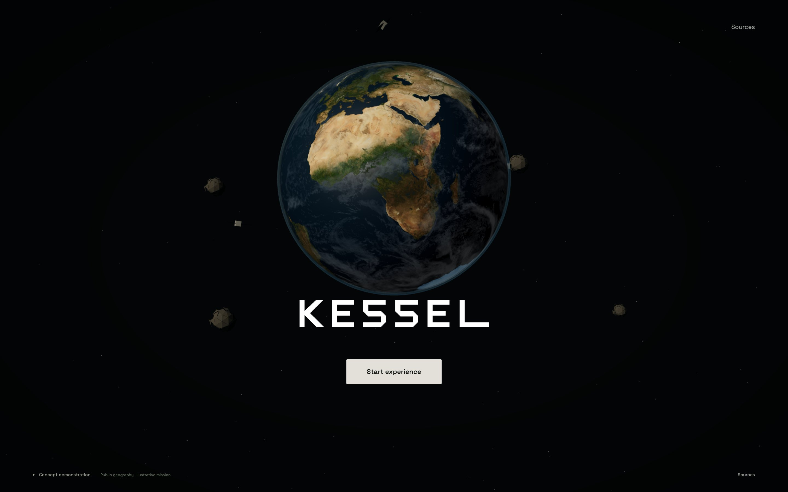
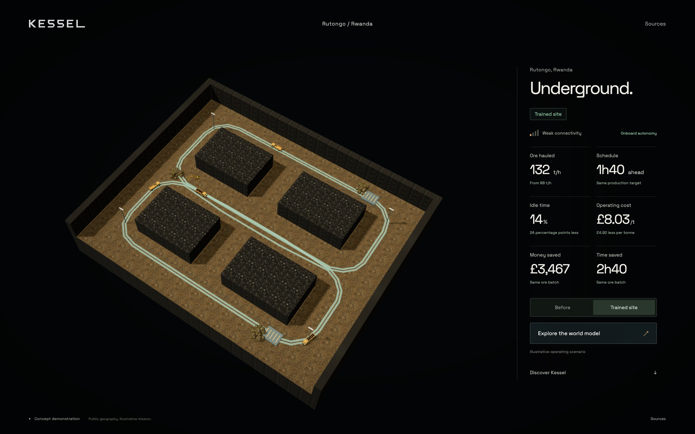
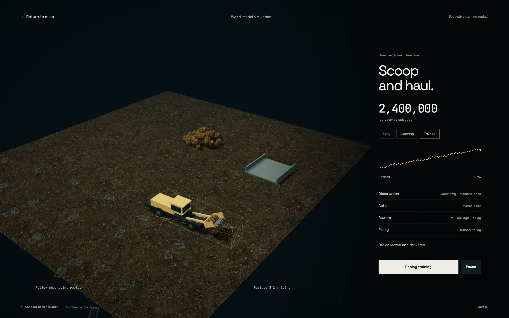

# Kessel

Physical AI for extreme environments, starting underground.

An interactive concept experience for Kessel's proposed offline autonomy
system. Earth leads into an illustrative mine at Rutongo, Rwanda. Compare an
inefficient fleet with a trained-site scenario, explore loader learning, then
scroll through the training pipeline and proposed retrofit kit.



## Run locally

```sh
python3 -m http.server 8080 --bind 127.0.0.1
```

Open [localhost:8080](http://localhost:8080) in Chrome. No installation, API key
or build step is needed. The presentation target is a MacBook Pro M1. Fonts,
Three.js, geographic textures, mine materials and models are served locally.
Use a static server rather than opening `index.html` directly.

## Experience

1. Start below the rotating Earth. Browse five deployment environments.
2. Choose **Underground**. Follow the continuous camera journey into Rwanda.
3. **Enter the mine** to reveal a tilted rock cutaway with four haul trucks
   and the licensed loading excavator. Red routes show the baseline queue.
4. **View the trained site**. Compare green haul loops and all six operating
   measures. Weak connectivity stays unchanged. Before/after is repeatable.
5. Optionally **Explore the world model**. An eight-second replay represents
   2.4 million authored episodes. Compare failed, improving and trained loader
   checkpoints, pause the replay, then return to the same mine or page position.
6. Scroll into world-model dynamics, reinforcement learning, policy
   distillation and onboard autonomy. Inspect and assemble the proposed kit.

Allow about 60 seconds for the main story. Optional exploration is separate.
There is no manual override, chase-camera flow or pricing section.





## What is real

Rutongo is a real tin operation. NASA Earth imagery, Copernicus surface
imagery and elevation provide public geographic context. The detailed site,
portal, underground layout, vehicles' behaviour, training results and operating
figures are authored. Public imagery is regional context, not a surveyed mine
reconstruction. The surface view uses one renderer and no embedded map.

This repository contains neither a learned dynamics model nor a trained
machine policy. It does not perform millions of simulations in the browser.
The permanent concept caption, illustrative labels and Sources explain this.
The kit is a proposed assembly, not selected or validated hardware.

See [asset credits](assets/README.md), the
[presenter guide](docs/phase-10/presenter-guide.md),
[visual review](docs/phase-10/visual-review.md) and
[verification report](docs/phase-10/verification.md).

## Structure and checks

`data/experience.json` owns the geographic context, themes, scene poses, rock
mass, directed haul routes, operating assumptions, loader keyframes,
checkpoints and kit components. `js/experience.js` controls one persistent
renderer and camera. Stage modules own their scene roots. The earlier Phase 9
mission and source modules remain for provenance.

```sh
python3 data/validate_experience.py
python3 data/validate_tunnel_network.py
for file in js/*.js; do node --check "$file"; done
```

CI runs both data validators and JavaScript syntax checks. For the local
browser acceptance, install Playwright in a parent tooling directory and run
`node scripts/verify-experience.cjs` with the server running. It uses installed
Google Chrome with native Metal graphics on macOS, captures frames and a
walkthrough, and records measurements under `/private/tmp`.

Copyright 2026 Nabil Shah / Kessel. Original work is proprietary. Third-party
assets retain the licences listed in their credit files.
