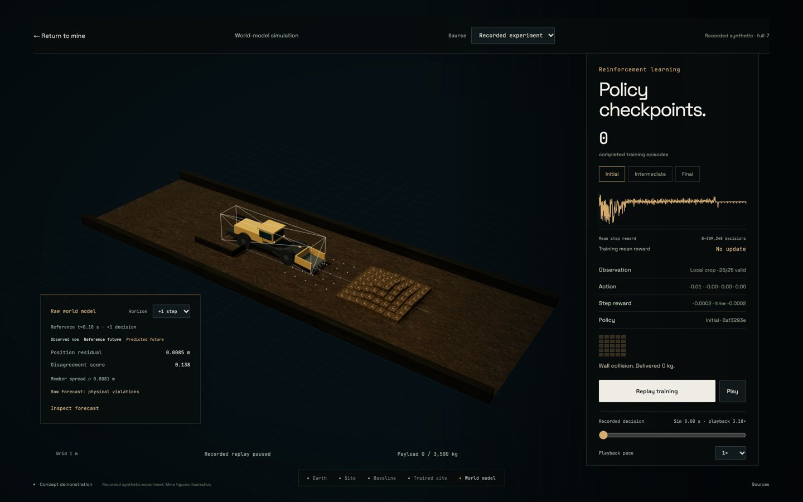

# Kessel

Physical AI for extreme environments, starting underground.

An interactive concept experience for Kessel's proposed offline autonomy
system. Earth leads into an illustrative mine at Rutongo, Rwanda. Compare an
inefficient fleet with a trained-site scenario, explore loader learning, then
scroll through the training pipeline and proposed retrofit kit.


## Run locally

```sh
python3 -m http.server 8080 --bind 127.0.0.1
```

Open [localhost:8080](http://localhost:8080) in Chrome. No installation, API key
or build step is needed. The presentation target is a MacBook Pro M1. Fonts,
Three.js, geographic textures, mine materials and models are served locally.
Use a static server rather than opening `index.html` directly.

## Experience

1. Start below the rotating Earth. Browse five deployment environments.
2. Choose **Underground**. Follow the continuous camera journey into Rwanda.
3. **Enter the mine** to reveal a tilted rock cutaway with four haul trucks
   and the licensed loading excavator. Red routes show the baseline queue.
4. **View the trained site**. Compare green haul loops and all six operating
   measures. Weak connectivity stays unchanged. Before/after is repeatable.
5. Optionally **Explore the world model**. A twelve-second recorded synthetic
   replay shows initial, intermediate and final checkpoint trajectories. Inspect
   actual sensor crops, actions and raw world-model forecasts. Failed outcomes
   stay visible. Choose Reference cycle for a complete conventional material cycle,
   Curriculum study for all three partial-pickup seeds, or the labelled concept replay.
   Pause, scrub or inspect timestamped events,
   then return to the same mine or page position.
6. Scroll into world-model dynamics, reinforcement learning, policy
   distillation and onboard autonomy. Inspect and assemble the proposed kit.

Allow about 60 seconds for the main story. Optional exploration is separate.
There is no manual override, chase-camera flow or pricing section.




## What is real

Rutongo is a real tin operation. NASA Earth imagery, Copernicus surface
imagery and elevation provide public geographic context. The detailed site,
portal, underground layout, mine vehicles' behaviour, concept training replay
and operating figures are authored. Public imagery is regional context, not a surveyed mine
reconstruction. The surface view uses one renderer and no embedded map.

Isolated CPU tools and retained experiment evidence include synthetic PPO
policies and learned state-dynamics ensembles. The optional viewer replays
identified synthetic decisions and raw forecasts; the bounded runs demonstrate
no complete learned delivery cycle. The browser performs no live training or
policy inference. The permanent concept caption, source labels and Sources
explain the boundary. The [replay follow-up](docs/phase-11/cycle-inspection.md)
adds checked reference cycles, volume-preserving ore and event inspection.
The [Blender report](docs/phase-11/blender-authoring.md) records editable authored
assets produced through the local MCP connection.
The kit is a proposed assembly, not selected or validated hardware.

See [asset credits](assets/README.md), the
[presenter guide](docs/phase-10/presenter-guide.md),
[visual review](docs/phase-10/visual-review.md) and
[verification report](docs/phase-10/verification.md).

## Structure and checks

Phase 11 CPU experiment tools are isolated in [training/](training/README.md).
The initial contracts, feasibility spike and static-package checks are recorded
in [the verification report](docs/phase-11/verification.md). They do not replace
the page's authored replay or establish learned machine-control performance.
The [model-free RL study](docs/phase-11/rl-experiments.md) now includes resumable
training, gated curriculum, policy evaluation, robustness and retained checkpoint
replays. Its bounded PPO runs achieved no complete delivery cycle. The measured
negative result and executable research artefacts are kept separately from the
concept presentation. The [world-model study](docs/phase-11/world-model-experiments.md)
adds learned dynamics, measured uncertainty, physical guards and an experimental
auxiliary critic. Explicit filtering allowed 4,719 imagined transitions and 45
critic updates, but no learned complete cycle or sample-efficiency improvement.
The [recorded integration](docs/phase-11/recorded-integration.md) now connects
verified checkpoint decisions and measured predictions to the optional viewer,
with a separate offline CPU export/compression comparison. The
[policy follow-up](docs/phase-11/policy-follow-up.md) retains bounded curriculum,
history and supervised warm-start comparisons; the
[world-model follow-up](docs/phase-11/world-model-follow-up.md) separates observable
and privileged inputs, soft conservation losses and equal-reference-budget assistance.

`data/experience.json` owns the geographic context, themes, scene poses, rock
mass, directed haul routes, operating assumptions, loader keyframes,
checkpoints and kit components. `js/experience.js` controls one persistent
renderer and camera. Stage modules own their scene roots. The earlier Phase 9
mission and source modules remain for provenance.

```sh
python3 data/validate_experience.py
python3 data/validate_tunnel_network.py
for file in js/*.js; do node --check "$file"; done
```

CI runs data validators, visual-asset/evidence checks, adapter tests and
JavaScript syntax checks. For the local
browser acceptance, install Playwright in a parent tooling directory and run
`node scripts/verify-visuals.cjs` with the server running for the current
visual and authored-journey scope. It uses installed
Google Chrome with native Metal graphics on macOS, captures frames and a
walkthrough, and records measurements under `/private/tmp`.

Copyright 2026 Nabil Shah / Kessel. Original work is proprietary. Third-party
assets retain the licences listed in their credit files.

Presentation JavaScript and CSS share one revision in the `index.html` import
map. Bump it consistently when changing those files. Verify it with
`python3 scripts/verify-presentation-version.py`. Run
`node scripts/verify-transition.cjs` for the warm-cache and entrance-recovery
regression. See [transition recovery](docs/phase-11/transition-recovery.md).
