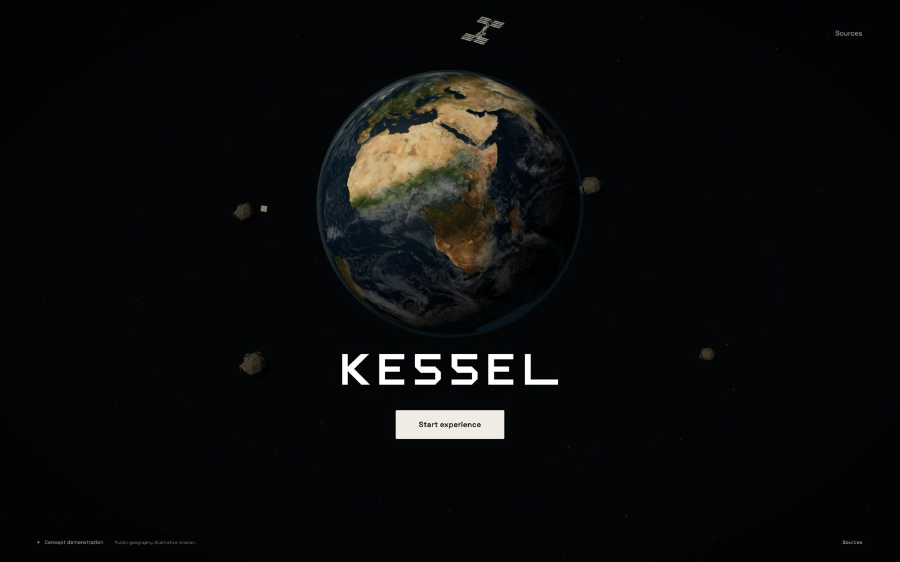
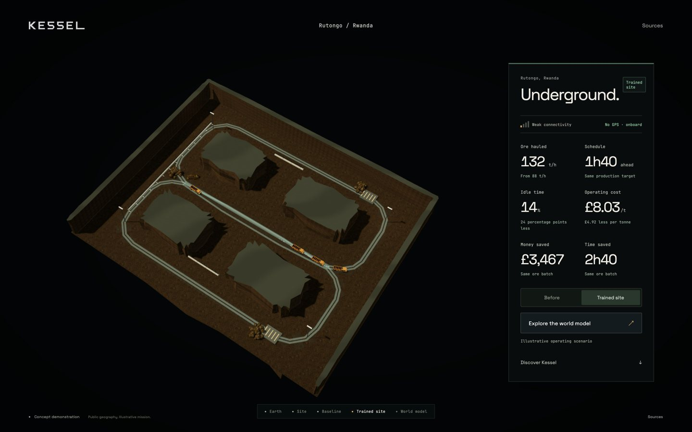
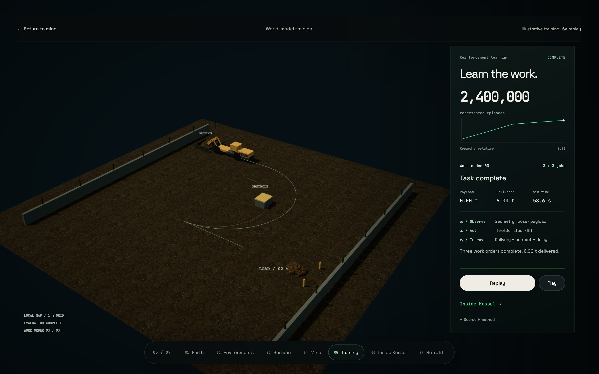

# Kessel

Physical AI for extreme environments, starting underground.

An interactive concept experience for Kessel's proposed offline autonomy
system. Earth leads into an illustrative mine at Rutongo, Rwanda. Compare an
inefficient fleet with a trained-site scenario, explore loader learning, then
jump between the training pipeline and proposed retrofit kit using a persistent
chapter rail. Each chapter resumes where it was left.



## Run locally

```sh
python3 -m http.server 8080 --bind 127.0.0.1
```

Open [localhost:8080](http://localhost:8080) in Chrome. No installation, API key
or build step is needed. The presentation target is a MacBook Pro M1. Fonts,
Three.js, geographic textures, mine materials and models are served locally.
Use a static server rather than opening `index.html` directly.

## Experience

1. Start below the photographic rotating Earth and original wordmark, with
   detailed spacecraft in illustrative orbits. Browse five full-screen environments;
   Underground is first and Earth moves into a compact context panel.
2. Choose **Underground**. A prepared fade introduces the original Blender surface. One finite truck
   haul turns through the yard, brakes and holds. A reduced-motion still,
   explicit replay and prepared live fallback share the same route.
3. **Enter the mine** to reveal a tilted rock cutaway with four haul trucks
   and the licensed loading excavator. Red routes show the baseline queue.
4. **View the trained site**. Compare green haul loops and all six operating
   measures. Weak connectivity stays unchanged. Before/after is repeatable.
5. **Explore the world model**. One illustrative training sequence progresses
   from a missed scoop and partial pickup to three complete work orders, including
   an obstacle-avoidance route. Episodes and rewards are represented, not measured
   policy results. Pause, resume or replay the finite sequence.
6. **Inside Kessel** retains the proposed pipeline and five optional technical
   chapters: perception, prediction, training/export, offline operation and fleet
   learning. Each technical chapter also resumes its own state.
7. **Retrofit** starts with the detailed proposed kit assembled. Open the exploded engineering view,
   select any of seven components, focus a part or drag to rotate. The signal
   view explains local sensing, estimation, policy inference and vehicle I/O. The seven-stop rail provides
   direct access to every chapter without page scrolling.

Allow about 60 seconds for the main story. Optional exploration is separate.
There is no manual override, chase-camera flow or pricing section.





## What is real

Rutongo is a real tin operation. NASA Earth imagery, Copernicus surface
imagery and elevation provide public geographic context. The detailed site,
portal, underground layout, mine vehicles' behaviour, concept training replay
and operating figures are authored. Public imagery is regional context, not a surveyed mine
reconstruction. The surface animation is a locally served 16-second original Blender film.
It uses scanned CC0 ground, rock, concrete and metal references, a CC0 MakeHuman
core mesh with original workwear and PPE, and the original Kessel truck. Its
visual direction remains a trial for review. It is not real mine footage.

Isolated CPU tools and retained experiment evidence include synthetic PPO
policies and learned state-dynamics ensembles. Retained research tools and the technical chapters use
identified synthetic decisions and raw forecasts; the bounded runs demonstrate
no complete learned delivery cycle. The browser performs no live training or
policy inference. Contextual source labels and Sources
explain the boundary. The [replay follow-up](docs/phase-11/cycle-inspection.md)
adds checked reference cycles, volume-preserving ore and event inspection.
The [Blender report](docs/phase-11/blender-authoring.md) records editable authored
assets produced through the local MCP connection.
The kit is a proposed assembly, not selected or validated hardware.

See [asset credits](assets/README.md), the
[presenter guide](docs/phase-10/presenter-guide.md),
[visual review](docs/phase-10/visual-review.md) and
[verification report](docs/phase-10/verification.md).

## Structure and checks

Phase 11 CPU experiment tools are isolated in [training/](training/README.md).
The initial contracts, feasibility spike and static-package checks are recorded
in [the verification report](docs/phase-11/verification.md). They do not replace
the page's authored replay or establish learned machine-control performance.
The [model-free RL study](docs/phase-11/rl-experiments.md) now includes resumable
training, gated curriculum, policy evaluation, robustness and retained checkpoint
replays. Its bounded PPO runs achieved no complete delivery cycle. The measured
negative result and executable research artefacts are kept separately from the
concept presentation. The [world-model study](docs/phase-11/world-model-experiments.md)
adds learned dynamics, measured uncertainty, physical guards and an experimental
auxiliary critic. Explicit filtering allowed 4,719 imagined transitions and 45
critic updates, but no learned complete cycle or sample-efficiency improvement.
The [recorded integration](docs/phase-11/recorded-integration.md) now connects
verified checkpoint decisions and measured predictions to the retained adapter,
with a separate offline CPU export/compression comparison. The
[policy follow-up](docs/phase-11/policy-follow-up.md) retains bounded curriculum,
history and supervised warm-start comparisons; the
[world-model follow-up](docs/phase-11/world-model-follow-up.md) separates observable
and privileged inputs, soft conservation losses and equal-reference-budget assistance.

`data/experience.json` owns the geographic context, themes, scene poses, rock
mass, directed haul routes, operating assumptions and kit components.
`data/training-demonstration.json` contains the separately authored work orders,
material ledger, machine articulation and tyre travel. It never replaces the
measured experiment records. `js/experience.js` controls one persistent
renderer and camera. Stage modules own their scene roots. The earlier Phase 9
mission and source modules remain for provenance.

```sh
python3 data/validate_experience.py
python3 data/validate_tunnel_network.py
for file in js/*.js; do node --check "$file"; done
```

CI runs data validators, visual-asset/evidence checks, adapter tests and
JavaScript syntax checks. For the local
browser acceptance, install Playwright in a parent tooling directory and run
`node scripts/verify-walkthrough-completion.cjs` with the server running for the
current guided-task, chapter, assembly and recovery scope. It uses installed
Google Chrome with native Metal graphics on macOS, captures frames and a
walkthrough, and records measurements under `/private/tmp`.

Copyright 2026 Nabil Shah / Kessel. Original work is proprietary. Third-party
assets retain the licences listed in their credit files.

Presentation JavaScript and CSS share one revision in the `index.html` import
map. Bump it consistently when changing those files. Verify it with
`python3 scripts/verify-presentation-version.py`. Run
`node scripts/verify-transition.cjs` for the warm-cache and missing-mine-asset recovery
regression. See [transition recovery](docs/phase-11/transition-recovery.md).

The [orbital home report](docs/phase-11/orbital-home.md) records the redesigned
opening and immersive environment selector. The [direction study](docs/phase-11/home-study/index.html)
retains two compositions, a shot animatic and native walkthrough footage.

The [cinematic chapter report](docs/phase-11/cinematic-chapters.md) records
the downstream scene work, native laptop checks and remaining visual sign-off.

The [engineering showcase report](docs/phase-11/engineering-showcase.md) records
the corrected evaluated truck orientation, directed route, aligned pipeline cards
and retrofit component/signal inspection under ADR-0055.
