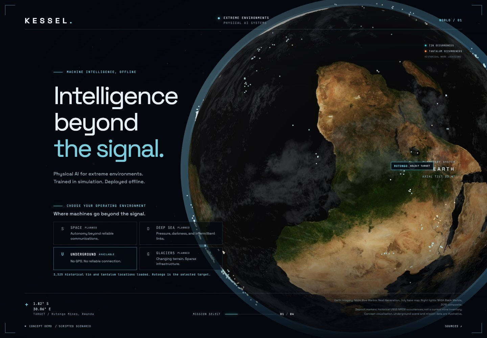
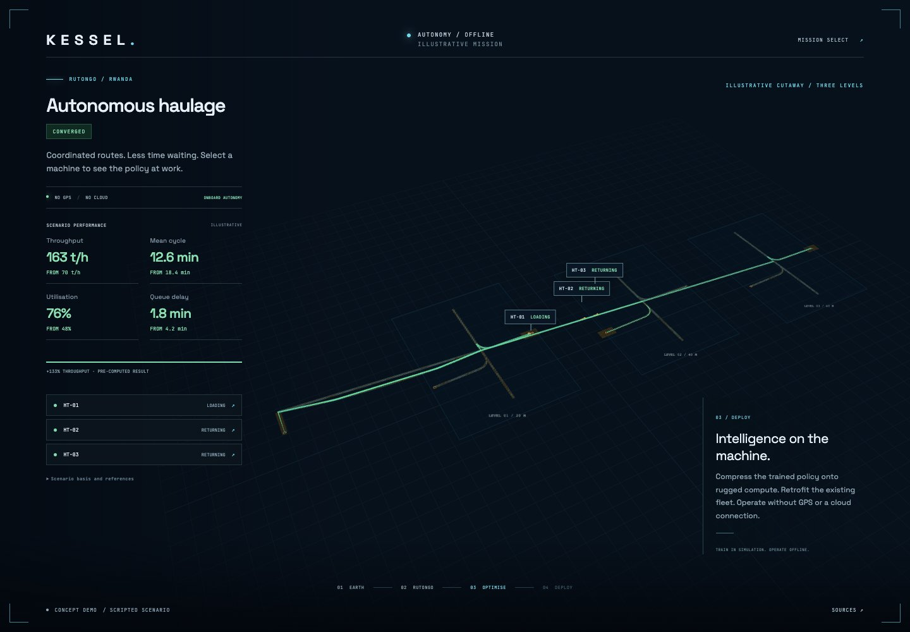
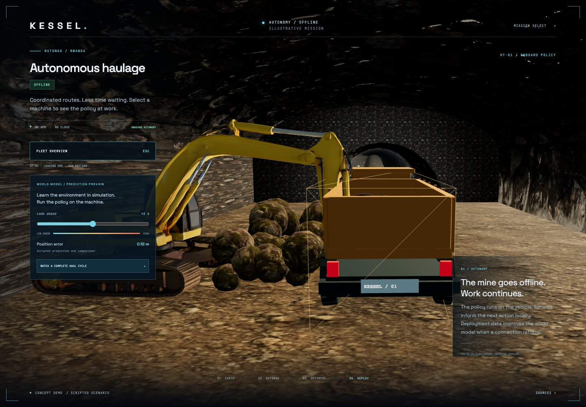

# Kessel

Physical AI for extreme environments, starting underground.

This repository is Kessel's interactive concept demo. It explains training
machine policies in a world model, compressing them onto rugged retrofit
compute and operating without GPS or a cloud connection. The training stack
and onboard runtime are separate products.



## Run locally

From this directory:

```sh
python3 -m http.server 8080 --bind 127.0.0.1
```

Open [localhost:8080](http://localhost:8080). No installation or build is
needed. Use a recent browser with WebGL enabled.

The surface stage uses an embedded Google Maps satellite view when online.
Choose **3D site** for the local terrain view. For a presentation without
internet access, open [localhost:8080/?offline=1](http://localhost:8080/?offline=1).
The core mission, fonts, rendering library, textures and vehicle models are
served locally. Do not open the HTML directly through a `file:` URL.

## Demo sequence

1. Select **Underground** from Earth. The other environments are planned.
2. Fly to Rutongo, Rwanda. Inspect the satellite map or the local 3D site.
3. Enter the mine. See three trucks sharing a constrained haulage network.
4. Run the **100,000 simulations** preview. Routes converge from red to
   green and the illustrative performance figures improve.
5. Select a truck through its fleet card or on the scene. Inspect the
   scripted prediction horizon and watch a full loading, haul, tip and
   empty-return cycle. HT-01's loading bay uses the licensed excavator.
6. Press **Escape** or **Fleet overview** to return. The result is preserved.
   **Mission select** restarts the experience.





## What is real

Rutongo is a real underground tin operation. The location, NASA Earth imagery,
USGS historical mineral occurrences and Copernicus surface context are public
sources. Google supplies its own satellite imagery and attribution through
the embedded map.

The underground layout, traffic, policy behaviour, predictions, optimisation
trace and performance values are illustrative. Pressing the button plays an
authored result; it does not train a policy or execute 100,000 simulations.
The permanent caption and Sources panel make this visible throughout.

See [asset credits](assets/README.md), the
[presentation guide](docs/demo/presenter-guide.md), and the
[Phase 9 verification report](docs/demo/phase-9-verification.md).

## Structure

- `data/mission.json`: mission, asset references, routes and illustrative results.
- `data/tunnel-network.json`: deterministic geometry and matching directed graph.
- `js/mission.js`: stage loading, transitions, HUD and camera.
- `js/underground.js`: cutaway and tunnel materials, loading scene and fleet.
- `js/fleet.js`: route following, haul phases and prediction preview.
- `js/vehicle.js`: original data-defined Kessel truck and its distance detail.
- `js/loading-machine.js`: the credited excavator's loading rig.
- `docs/adr/`: decisions, assumptions and source references.

Validate the mission with `python3 data/validate_tunnel_network.py`.
JavaScript syntax and mission validation also run in GitHub Actions.

Copyright 2026 Nabil Shah / Kessel. Original work is proprietary. Third-party
assets retain the licences listed in their credit files.
