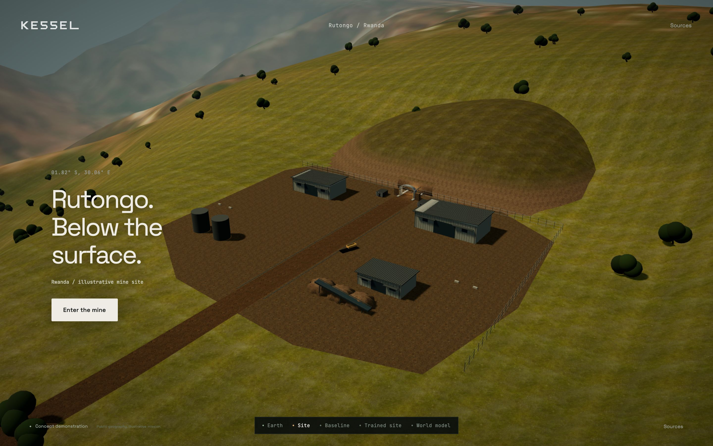
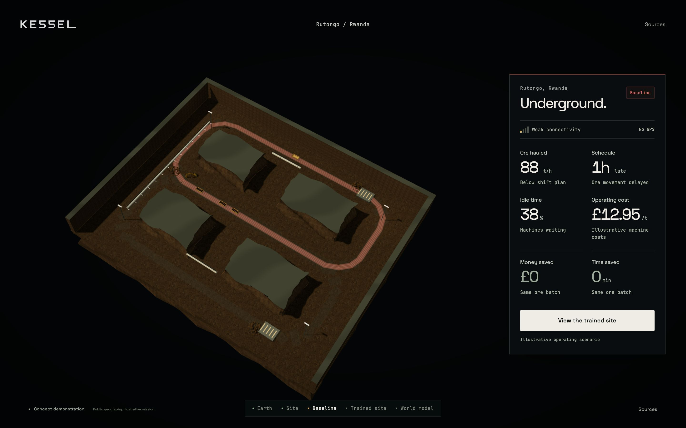
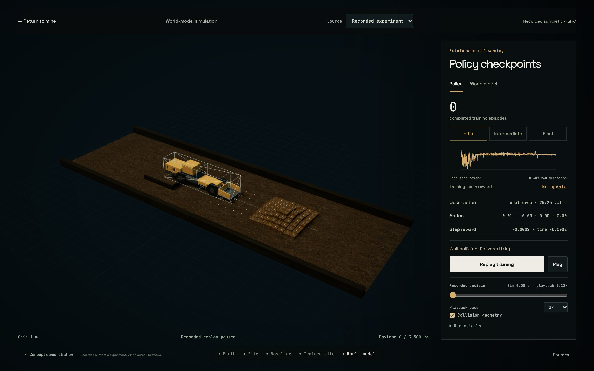
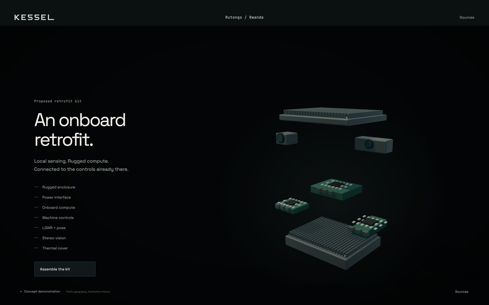

# Local Blender authoring and web adoption

Refs #306, #331–#342. Decision: [ADR-0048](../adr/0048-local-blender-authoring.md).

The maintainer's Blender 5.2.3 LTS is connected through MCP for Blender 2.2.7,
revision 2e4b0bc294694b1570d76ed01be657c22e6d02a0. The local stdio client talks to
127.0.0.1:9877 with safe mode enabled and telemetry disabled. Inspect, create,
render, .blend save and GLB export were actually executed through the connector.
The [connection record](blender-evidence/connection.json) and small GLB/JPEG proof
are retained. Repeated independent clients verify reconnect behaviour. Close the
separate authoring window to stop the server; restart instructions are in
[tools/blender](../../tools/blender/README.md). No hosted asset generator is used.

Eight bounded GLBs are adopted in the running page: a closed irregular
geological section, portal/yard, detailed and overview haulers, original ore,
reference loader, licensed excavator derivative and proposed kit. A roughness/
normal-aware world-space material avoids treating Blender node coordinates as
Y-up geometry. Section caps remain distinct. Vehicle/body materials are isolated
per instance so one scene's crossfade cannot change another scene's machinery.

The close hauler has 18,600 triangles; its actual reduced LOD has 7,802. Both
retain wheel/dump-bed pivots. The reference loader's 3,524 triangles use the
same physical frames as the audited reference rig. Logged pose, joint, wheel
and exact terminal samples are retained as linear channels; browser playback
does not run an independent animation clip. The excavator's original 14-node,
11-joint source remains byte-for-byte intact, with CC BY 4.0 credit. The Blender
derivative has unique source-index joint names and packed editable-source images.

The kit has separate metal, PCB, coating and lens detail with component pivots.
Its source enclosure is approximately 340 x 260 mm, displayed at tenfold scale
for inspection. Assembly and exploded transforms remain authored/proposed.
Original normal and AO bakes are 512 square, retained under tools/blender/bakes;
pixel-exact lossless WebP derivatives are served locally. A reusable packed
PBR library retains the individually cleared rock/ground maps and channel spaces.

The bounds audit finds no open geological boundary. Positional welding finds
20 shared non-manifold edges where the separate closed sections meet; this is
a compound visual assembly, not a Boolean-unioned collision solid. Hub widths
and the reference bucket envelope were corrected from the measured bounds.

Every derivative has a source .blend, source-script and original/derivative hash
in [the manifest](../../assets/authored/manifest.json). The official Khronos
validator reports zero errors for all eight GLBs. The inherited excavator
non-root skinned-mesh warning is retained, not hidden. Native pose/adoption checks
exercise the actual Three.js result. Static checks reject required extensions,
external buffers/images, oversized geometry, broken joint identifiers and
non-linear reference clip interpolation. Editable scenes, raw bakes, MCP and
research codecs are excluded from the static package, which totals 29.2 MB here.

## Native evidence and limits

[Native adoption/fallback report](blender-evidence/native.json) uses Chrome
156.0.8078.81, ANGLE Metal Renderer: Apple M1, at Retina 1440 x 900 (renderer cap
1.5). The existing two-size HUD regression also passes. The complete path adopts
all eight models, preserves paused geometry inspection, reaches the proposed kit
and retains the original closed cutaway when authored geology is deliberately
unavailable. Default scenarios have no page, shader or HTTP errors.

The initial measurement exposed a 433 ms entry frame. Asynchronous compilation
now covers opaque/transparent materials, with/without surface fog and the actual
combined-light transition. Texture uploads are staged before entry. On the retained
run, active entry averages 40.92 fps with p99 133.4 ms; the mine averages 60.01
fps with p99 16.8 ms, and trained view averages 59.24 fps with p99 16.8 ms. These
are not uninterrupted 60 fps claims. The short startup bucket includes a 366.7
ms initial GPU frame before readiness. Preparation is measured separately;
scene loading remains visible and genuine. No release qualification is claimed.

The [texture comparison](blender-evidence/texture-study.json) records the same
512-square normal map as PNG, lossless WebP, an atlas and KTX2/UASTC, with aligned
UV orientation and shader warm-up separated. WebP is 371,500 bytes versus PNG's
469,620, with identical pixels and the same estimated 1 MiB GPU storage. KTX2 is
262,416 bytes and estimates 256 KiB on native ASTC, but adds 562,272 bytes of
one-time decoder assets, 149.4 ms local load/transcode and lossy differences
(42.62 dB PSNR; maximum channel error 51). These single local samples are not a
broad codec benchmark. The chosen small-map WebP path needs no runtime decoder.

[Matched-camera material metadata](blender-evidence/material-calibration.json)
retains an AgX Blender render and ACES browser frame. Geometry, camera and
material are shared; the nominal point-light conversion and exposure are stated.
It is a colour-management comparison, not calibrated photometric equivalence.
No independent looping animation, model success, machine deployment, surveyed
mine geometry or measured business saving follows from these visuals.

