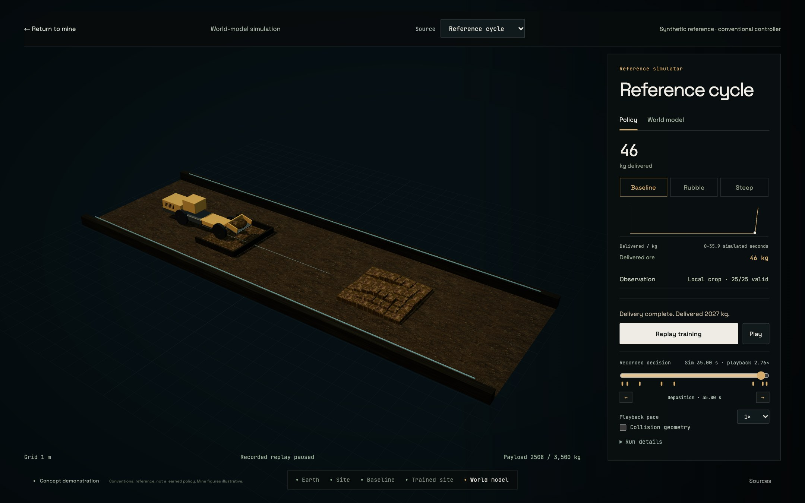
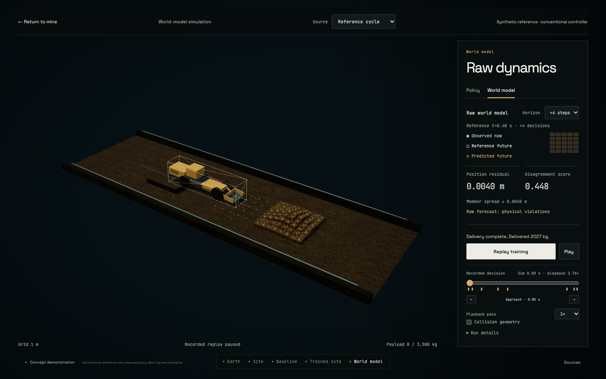

# Recorded cycle inspection

Refs #323–#330 and #261. Decision: [ADR-0050](../adr/0050-recorded-cycle-inspection.md).
Release tickets #271–#276 remain untouched.

The optional viewer retains the original twelve-second policy comparison and
adds two distinct sources. Reference cycle shows the conventional observation-only
controller on the first declared held-out seed, with baseline, rubble and steep
piles. Curriculum study shows all three declared curriculum training seeds on the
first declared test scene. Partial pickup stays visible; every displayed learned
case still hits a wall and delivers zero ore. The curriculum display is a post-hoc
illustration, not an efficacy estimate or a favourable test-seed selection.

Reference bundles contain 956 independently replayed decisions and 1,079 raw
forecasts. The curriculum bundle contains 178 decisions and 217 raw forecasts.
Exporters verify physical states against fresh action execution and retained
policy traces, including the actual deterministic checkpoint actions. Every
reference state is checksummed. World-model selection uses validation error,
never test performance. All three bundles are hash checked before browser use.
[Reference export](reference-viewer-export.json) and
[curriculum export](curriculum-viewer-export.json) retain identities and counts.

One clock owns pause, pace, scrub, finite terminal holds and replay. Phase and
material markers seek exact logged boundaries; previous/next controls work from
the keyboard. Transfer markers ignore numerical noise below 1e-6 kg, while exact
states and transfers remain retained. Observations, actions, rewards and material
change only at recorded decisions. Pose and wheel interpolation are visual only.
Forecast shapes are hidden in Policy and appear in World model with distinct
observed points, dashed reference outline, raw predicted envelope and residual
line. Missing forecasts and physical violations remain visible. Member endpoint
spread is conditional and is not calibrated confidence.

The source height field has a shared boundary and inset cell plateaux rather
than detached columns. Each triangle integral exactly preserves its physical cell
volume; zero-height cells stay empty and the footprint stays fixed. Relief above
a cell mean is explicitly bounded by the inset coefficient. Receiver and spill
surfaces use actual delivered/spilled kilograms and density. Carried ore follows
the physical bucket frame. Sixteen decorative transfer fragments and the spill
centroid are visual proxies, disclosed in Run details. They add no accounted mass.
The reference remains an 8×8 height-field approximation, not granular fracture.

The training bay uses existing cleared ore/floor colour and OpenGL normal maps,
contact shadows, restrained service lighting and the Blender-authored loader rig.
The renderer retains procedural fallback geometry if that GLB is unavailable.
No manual controls, pricing, live training or backend service is introduced.

## Verification

The complete CPU suite passes 138 tests. Adapter tests cover variable schedules,
post-action event clocks, corrupt bundles and controller/policy identity. Geometry
tests verify each cell integral, holes, metre bounds and relief limits. Native
Chrome checks exercise successful and failed reference cases, every curriculum
seed, all forecast horizons, source switching, terminal boundaries, keyboard event
inspection, reduced motion, missing-bundle retry and the short laptop layout.
The original twelve-second replay still takes about 12.01 seconds and restores
mine/product focus and scroll correctly.

[Native cycle report](cycle-inspection-evidence/report.json),
[legacy replay checks](cycle-inspection-evidence/legacy-report.json), and captures
in the same directory retain results. Settled playback is approximately 60 fps
on Chrome 156 / ANGLE Metal / Apple M1 at 1440×900, DPR 1.5. A local cold-entry
sample and frame tails are reported separately below. These are specific browser
samples, not qualification of every scene, machine or startup condition. The
broader release performance and accessibility audit remains deferred.

The final local cold-entry window records p99/max 16.8 ms; an earlier local
run reached 33.4 ms. Settled playback records p95 16.7 ms, p99/max 16.8 ms
and 60.22 fps. The final sampled heap is about 50 MB with the source cache
populated; other captures reached about 70 MB. This is JS heap, not process
or GPU peak memory. First-use preparation takes about 176 ms before reveal.

