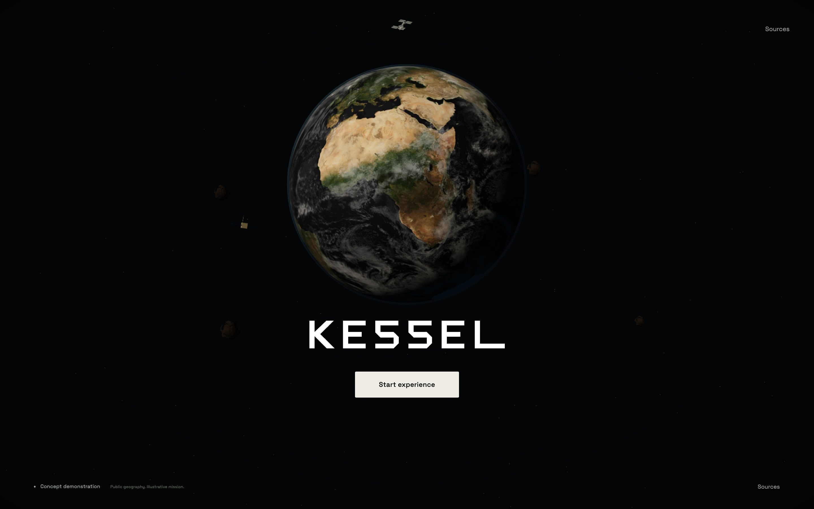
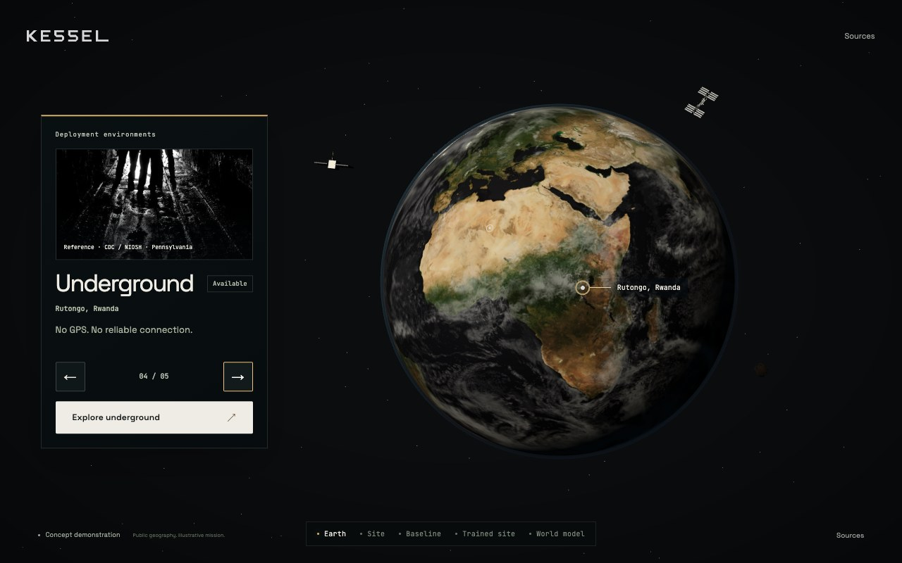

# Home and environment presentation

7 November 2026. Refs #298–#303. Decision: [ADR-0046](../adr/0046-home-environment-presentation.md).

Earth retains the cleared NASA day, cloud and night layers and established
geographic orientation. A neutral directional sun now supplies the same vector
to the surface, night lights and atmosphere when the presentation root moves.
The ocean response, cloud shell, cloud shading and thin atmospheric limb are
restrained. Earth remains dominant above the lower wordmark and one start button.

The decorative NASA ISS is smaller, the original satellite has differentiated
body, array and antenna materials, and sparse asteroids use the existing cleared
rock maps. The seeded star field varies size and brightness without animated
sparkle. All orbital motion is static with reduced motion. These are decorative
orbits, not a current orbital catalogue; the planned lunar scene remains a
simple placeholder body.

The selector has five locally served photographic references, short place text,
stable navigation/count and reserved action space. Only underground is
available. Full credits and original pages remain in Sources; the CDC photo
explicitly identifies Pennsylvania rather than Rutongo. Individual records,
source/derivative hashes, crop operations and the 277,482-byte total are in the
[asset manifest](../../assets/environments/manifest.json).

The 1.55-second arrival and selection move share the existing camera clock.
An early Start replaces the arrival destination. Pins and labels use the same
actual transform; far-side, off-screen and overlapping labels hide. Selection
settles before ordinary rotation resumes; reduced motion snaps directly to the
selected longitude. UI/background colours change while Earth keeps neutral
illumination. Mine prefetch waits until the selector has settled. Mandatory
Earth readiness precedes entry; optional cloud/photo failures retain a usable
experience. All 19 local modules and five styles use revision 2026-11-07.3.

## Verification

[Native report](home-evidence/native.json),
[HTTP-cache/transition report](home-evidence/cache-transition.json) and
[frame hashes](home-evidence/frames.json). Tests use Chrome 156.0.8078.81 with
ANGLE Metal Renderer: Apple M1, at 1440 × 900/device scale 2 (renderer capped at
1.5) and 1280 × 800/DPR 1. Normal and reduced-motion checks cover all choices,
coordinates transformed independently from latitude/longitude, label alignment,
carousel input, panel bounds, actual layer readiness and source records. Early
Start interruption, an aborted optional cloud/photo, vector fallback and the
next successful image are checked separately.

Fresh browser contexts measure frames during the first 5.5 seconds, including
local first-use loading and shader work. This is local HTTP, not a throttled
remote network or a cold operating-system file cache. At 1440 × 900 normal
motion, mean is 53.74 fps, p95 16.8 ms and p99 83.3 ms. At 1280 × 800 reduced
motion, mean is 55.99 fps, p95/p99 16.8 ms. Both settle at 60.00 fps with p99
16.8 ms. The normal first-use tail records a remaining shader/loading hitch;
these figures do not claim uninterrupted 60 fps.

Both paths complete Earth → surface → underground → trained site, retaining
correct scene visibility and comparison state. Real returning HTTP caches use
the versioned graph instead of primed stale modules/styles. The unversioned
negative control fails as expected. Missing entrance data retains the surface
with a working reload/retry route. Default scenarios have no page, shader or
HTTP errors; the fallback case deliberately aborts two optional asset requests.

Reproduce with `scripts/verify-home.cjs` and `scripts/verify-transition.cjs`, using
an external Playwright installation and native Chrome. Static validators check
hashes, photo budget, layer bounds and the module/style revision graph. The
maintainer's existing 63% wordmark-position edit is preserved in the local
working tree and excluded from these commits. This work adds no new learned
result and does not resolve the recorded-simulation follow-up in #305.

The matched reduced-motion Africa views are
[before](home-evidence/before-hero.jpg) and
[after](home-evidence/after-hero-matched.jpg).
