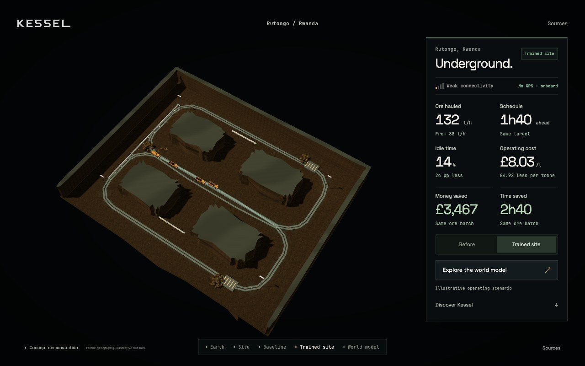
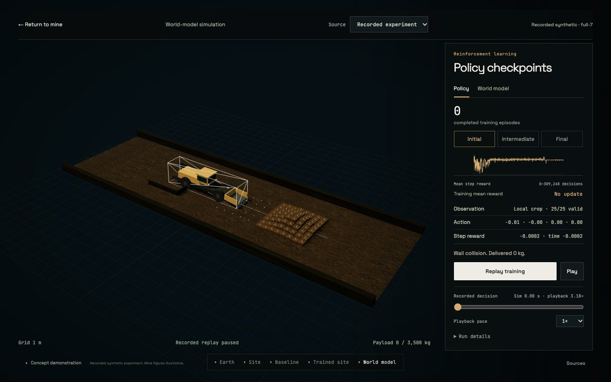
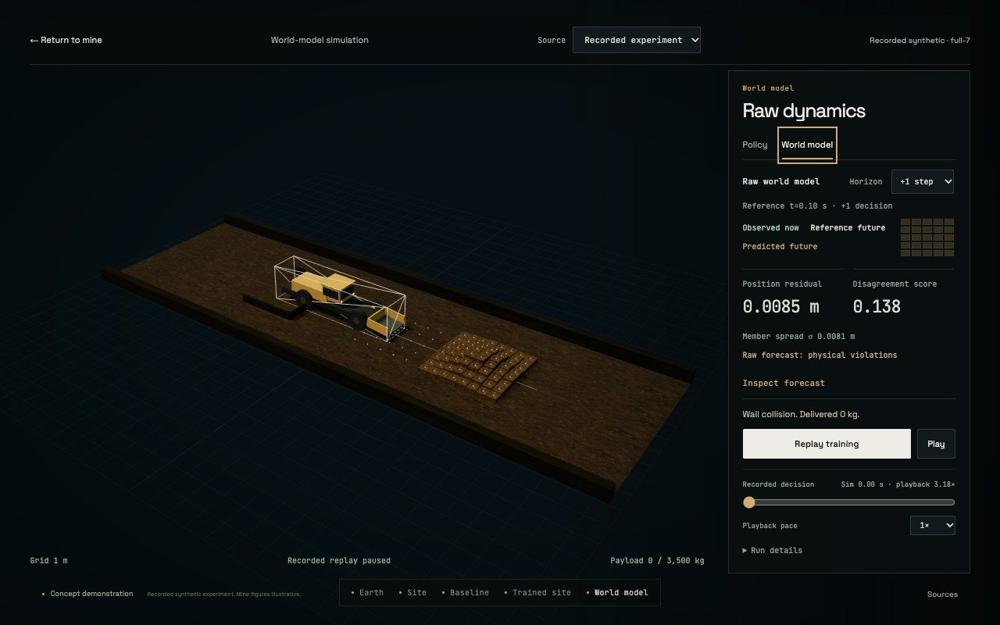

# Laptop HUD refinement

7 November 2026. Refs #297, following #277–#281 and the entry fix in #295.

The mine now uses larger outcome values, readable labels and a stable two-column
metric grid. Savings have their own separator. Connectivity and no GPS remain
constraints in both scenarios. The illustrative scenario label stays visible.

The learning interface uses one right-hand rail. Policy and World model tabs
replace the separate forecast overlay, leaving the left side for the 3D task.
The existing mean-reward curve and policy readouts live in Policy; raw forecasts,
residuals, disagreement, the local height crop and physical-violation status live
in World model. Playback controls and actual outcome text stay in a persistent
footer. Only instrument content scrolls when space is limited.

Keyboard arrows and Home/End move between the two tabs. Selecting another source
resets the instrument view. The concept replay retains its original observation,
action, reward and policy fields. Switching instruments never seeks the recorded
clock. The reported recorded-playback mechanics remain deferred.

The first-scene [research and ticket list](../research/2026-11-07-hud-and-first-scenes.md)
records the next home/globe and environment-selection work separately. This HUD
pass does not claim that #298–#303 are implemented.

## Verification

[Native report](hud-evidence/native.json) and
[frame manifest](hud-evidence/frames.json). Chrome 156.0.8078.81, ANGLE Metal
Renderer: Apple M1. Laptop views at 1280 × 800/DPR 1 and 1440 × 900/device scale 2
(renderer capped at 1.5) pass source switching, tab keyboard interaction, outcome
and playback-control bounds, source/constraint labels, unchanged paused replay
time, return to the trained mine and a settled frame-budget check. The panel has
no horizontal overflow. There are no page, shader or HTTP errors in those checks.

`scripts/verify-hud.cjs` repeats the layout checks. The cache/entrance regression
also passes with four versioned styles. The existing wordmark-position edit is
preserved outside this branch's commits. Presentation revision: 2026-11-07.2.

