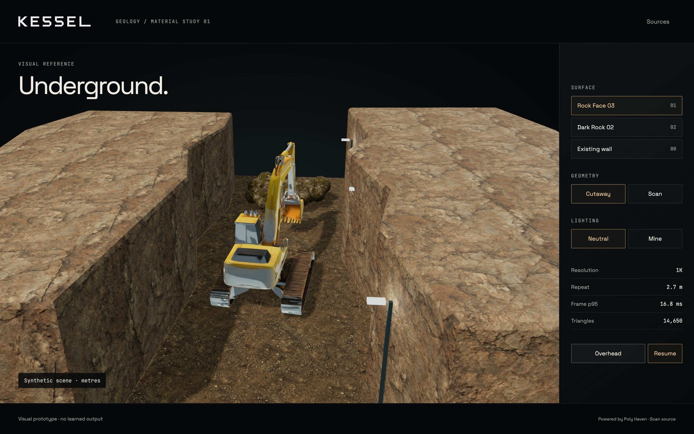
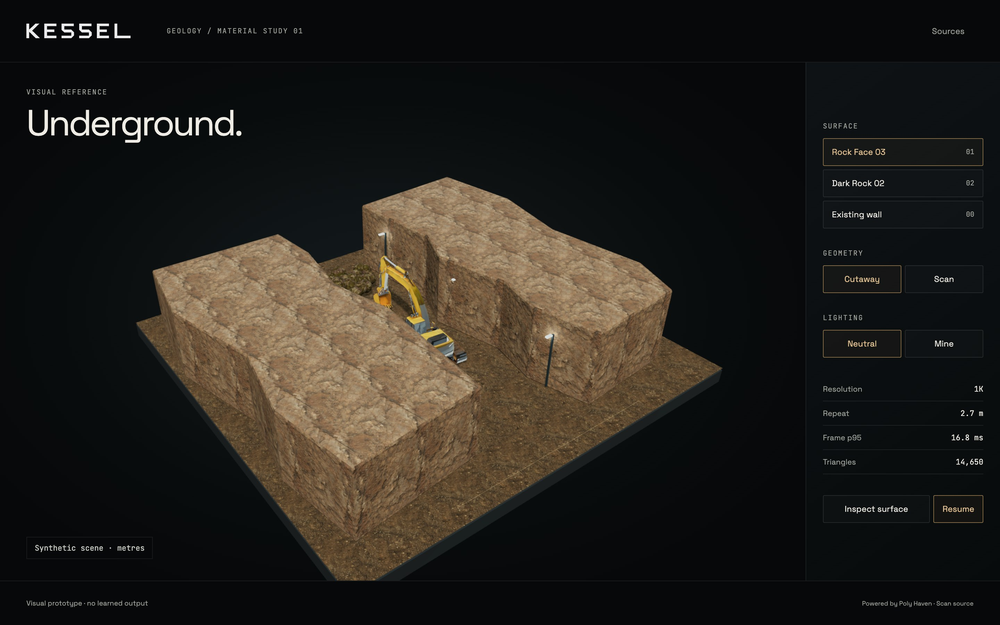
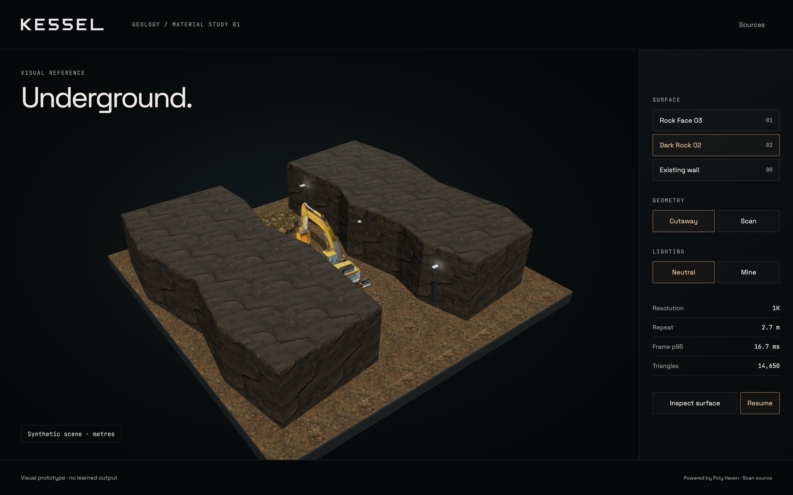
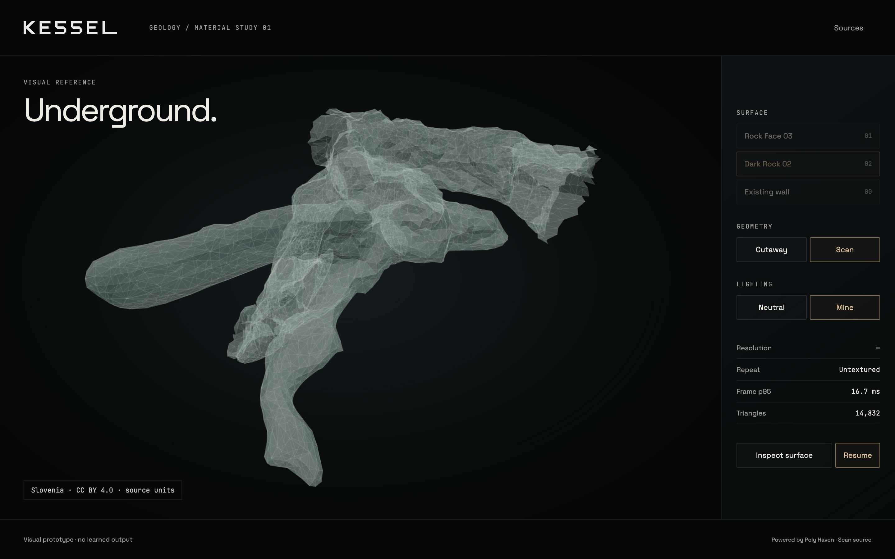

# Material-study verification

Measured 6 November 2026 at source commit
`c8fef56ed5e128eb482a81f561e04fbd970a786f`. Chrome 156.0.8078.81,
native ANGLE Metal Renderer: Apple M1. Main viewport 1440 x 900, device scale
2, renderer DPR capped at 1.5; 1280 x 800 and reduced motion also checked.
[Raw report](verification.json). Issues #201, #202 and #203.

## Results

All four browser groups pass. The seven settled samples are approximately
60 fps, with p95 frame times around 16.7-16.8 ms and no page/HTTP errors.
The cutaway renders 14,650 triangles in 13 draw calls. The separately displayed
scan has 7,416 source triangles; its translucent double-sided rendering and
edges use three calls and report 14,832 rendered triangles. These are different
counts by design, not extra source geometry.

Material switching, both lighting modes, continuous camera inspection, pause,
geometry switching/restoration, source disclosure and keyboard dialog dismissal
were exercised. Reduced motion starts paused and settles camera changes without
animation. It is still possible to explicitly resume the illustrative joint
motion. All requests were local static files.

The Python asset check verifies eight map hashes/provider MD5s, their declared
roles, scan provenance, finite geometry and the dated retained-file snapshot.
Three deterministic preparation tests pass. Both existing demo validators,
JavaScript syntax and whitespace checks pass.

These are settled prototype measurements. The report does not measure every
first-use shader/upload hitch or qualify a rebuilt full mine. Main-scene
integration, texture packing/LOD comparison and full release verification
remain in their existing tickets. No policy or world model is trained here.

## Visual findings

Rock Face 03 provides the clearest primary geological surface near the
excavator. Dark Rock 02 offers secondary strata, but repeated horizontal bands
become prominent across large areas. The old wall reads as assembled stone.
The two natural candidates share a 1K resolution and 2.7 m display repeat; the
old 512 px wall comparison also includes a resolution difference.

The synthetic shell remains deliberately coarse. Fine fracture shading does
not replace larger silhouette changes, irregular headings, wetness and ground
variation in the later geometry/material tickets. The licensed excavator stays
legible in the inspection view and retains its original rig and credit.
The public scan is kept separate, untextured and labelled in source units.

## Maintainer review

The implementation and measured behaviour are recorded separately from visual
acceptance. The prototype is available for review at
`/docs/phase-11/lookdev/` on the local static server. No maintainer approval of
this new material direction or final mine appearance is assumed.
