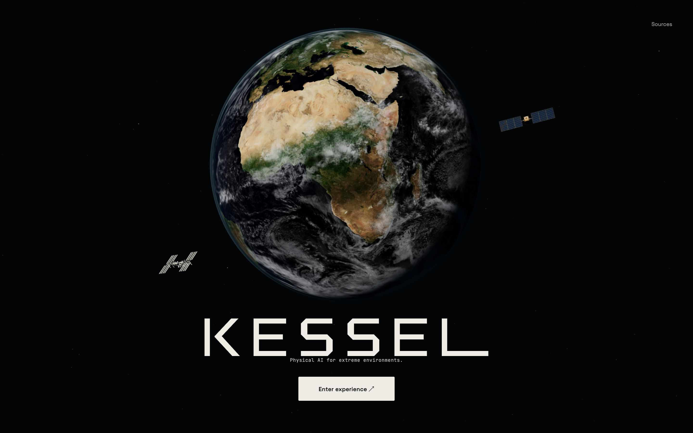
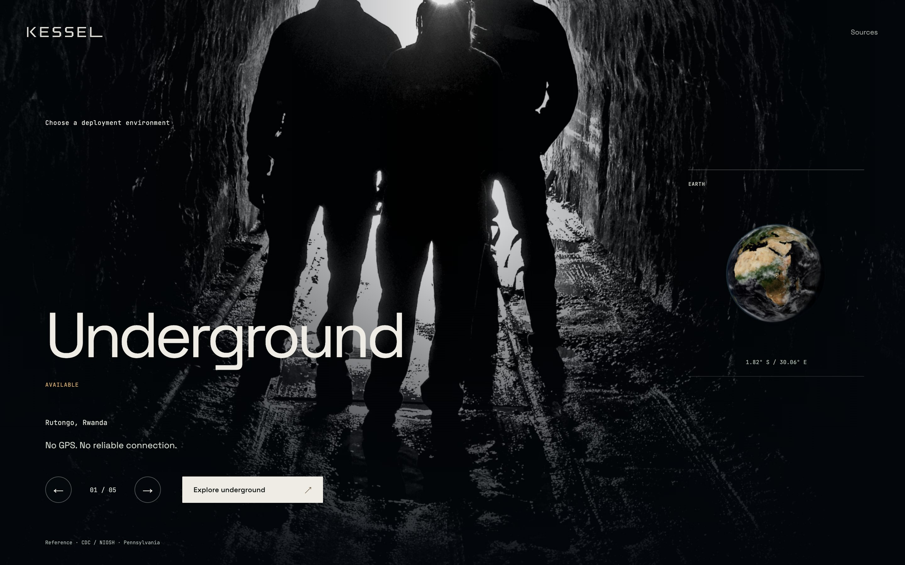

# Orbital home and immersive selection

8 November 2026. ADR-0052, following ADR-0051. Refs #351–#358, #375 and #381.
[Playable direction study and shot animatic](home-study/index.html).

The opening now uses a much larger Earth, an original off-white vector wordmark,
a detailed observation spacecraft and the distinct NASA ISS. A new linear-colour
surface shader blends NASA day/night imagery through one world-space terminator.
Cloud light, shadow and atmospheric limb share that sun. Orientation, axial tilt
and real geographic marker frames are retained. The old heuristic ocean mask and
nearby asteroid props are removed. A restrained pixel-sized star field replaces
the almost invisible previous points.

The original spacecraft was actually created through the pinned Blender MCP in
a separate Blender 5.2.3 LTS authoring instance. Solar cells/interconnects,
insulation quilts, radiator channels, optical baffles, dish supports and deployment
hardware are geometry. The close model has 29,532 triangles; the reduced model
has 11,219. Their apparent sizes and orbits are authored presentation scales, not
live tracking. Editable .blend files, source scripts, derivative hashes and a
[source render](orbital-home-evidence/satellite-source.png) are retained. Both
new GLBs pass the official validator without errors or warnings. The inherited
excavator warning remains separate and unchanged.

Selection is now a full-screen photographic environment, with one real Earth
inside a small right-hand context frame using the same renderer. Underground is
first/default; the others are previews. No second WebGL renderer or external map
service is introduced. Five 1440–2048 px background derivatives total 1,358,086
bytes and have source hashes, notices, focal crops and exact output hashes in
assets/environments/backgrounds.json. The Pennsylvania research-mine photograph
is representative, not Rutongo. No photo was synthesised or upscaled.

Two decoded layers crossfade. A latest-request token prevents delayed images from
overwriting a newer choice. Optional large-photo failures use the retained
preview with a brief resolution label. Adjacent images warm progressively;
loading is visible and browsing remains usable. Earth's shared sunlight stays
fixed while the chosen geographic point settles and rotation resumes. Lunar
selection does not invent an Earth location.

The home fades in and its globe moves into the context panel on Start. The
Rwanda hand-off uses a clean fade after destination preparation rather than the
previous miniature-globe flight. Keyboard entry, repeated input, resize and
reduced motion retain one logical stage. The global concept footer is removed
under the maintainer's explicit instruction. The operations scenario, recorded
source, proposed kit and image/provider credits retain their contextual wording
and reachable Sources information. The hidden old caption-state binding is not
used as a visible substitute banner.

## Evidence and limits

[Native report](orbital-home-evidence/native.json),
[cache/recovery](orbital-home-evidence/cache-recovery.json),
[transfer measurement](orbital-home-evidence/route-bytes.json),
[glTF validation](orbital-home-evidence/gltf-validation.json).

Chrome 156 with ANGLE Metal / Apple M1 passes 1440×900 Retina, 1365×768 compact
and 1280×800 reduced-motion runs. The real captures include all five scenes,
correct geographical frames, rapid selection, keyboard navigation, Sources,
optional spacecraft/cloud/photo failures and the complete mine hand-off. The
normal walkthrough also reaches the conventional reference and proposed kit.
Both settled home and selection samples are approximately 60 fps, with p95/p99
around 16.7/16.8 ms. Local readiness is 0.60–0.91 seconds. Startup GPU frames
before readiness reach 333–417 ms; these are retained separately, not described
as uninterrupted 60 fps. Cold main-route responses through the kit total about
17.2 MB including headers, below the 28 MB budget; optional experiment datasets
are excluded from that main-route measurement.

Visual inspection found an initially clipped foreground satellite. Its orbit
plane was adjusted and projected bounds were added to the browser acceptance.
The final captures retain the corrected full silhouette at each laptop size.
Two actual hero/wordmark compositions are available in the study. The primary
centred direction is implemented; the instrument variant remains an explicit
comparison. No maintainer visual judgement is inferred from these checks.

The surface, cutaway, learning renderer and kit are shown in the animatic using
the current real route; their separate realism/replay tickets remain open. This
batch implements the home and selection sequence, not those later rebuilds or
a release/publication. The maintainer's pre-existing prototype directory and
base wordmark-position edit are preserved and excluded from these commits.

