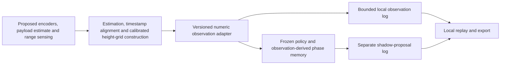

# From proposed sensors to a local synthetic runtime

22 November 2026. Refs #408, #417–#419. Decision: ADR-0062.

The new implementation accepts **already computed numeric observations** and
records shadow policy proposals. It does not turn camera images or raw range
returns into a map, select vehicle hardware, apply calibration transforms or
send commands to a machine. Those interfaces remain real engineering work.

The first box is proposed hardware. Estimation and raw range processing are not
implemented by this prototype. The adapter, logger and synthetic shadow probe
are executable. They work without a network connection or hosted service.
There is no applied-machine-command stream.

## Observation boundary

`training/kessel_lab/observations.py` validates version, clock identity,
calibration identifier, frame convention, channel identity/units, ordered capture
and delivery times, finite shapes and validity. It supplies the same 15 proprio
fields, 25 local heights and 25 validity values used by the existing actor.
Phase context is conventional memory derived from that observation sequence.

| Channel | Shape and units | Coordinate/timing convention |
| --- | --- | --- |
| Proprioception | 15 named fields; metres, m/s, radians, kg, seconds and dimensionless flags/ratios | Odometry and heading in a local map frame; receiver displacement in the chassis frame; calibrated joint estimates |
| Local height | 5 × 5 metres | Front/bucket-mouth sample locations, ground height datum; 0.75 m spacing |
| Range validity | 5 × 5 boolean | Same locations and calibration epoch as the height crop |

The packet's frame identifier names this combined convention, not one transform
that can be applied to every field. Heights are precomputed, not raw LiDAR or
stereo pixels. Receiver displacement assumes a known local target. A calibration
identifier is checked against the caller's expectation; it is not evidence that
the real calibration was measured or that transforms were applied correctly.

Capture-to-use age is computed separately per channel. Capture must precede
delivery and delivery must precede use on the same declared clock. A 0.2-second
prototype age threshold masks stale range cells and zeroes invalid heights;
stale proprioception rejects the proposal. It is a declared synthetic threshold,
not a validated sensor tolerance or a stopping guarantee. Missing information
must not masquerade as a measured zero-height surface. Multi-clock conversion,
pose interpolation and raw-perception alignment belong upstream.

## Local recording and replay

`training/kessel_lab/recorder.py` keeps observation and shadow-proposal sequences
separate in one append-only hash chain. The run header binds checkpoint and
calibration identity. It rejects duplicate/decreasing sequences, records gaps,
checks checksums on replay and refuses a mismatched run/checkpoint header.
No command is described as applied to a machine.

Every accepted append flushes and fsyncs the file. A byte quota refuses new
records while retaining committed data. Interrupted final records require explicit
recovery: save the incomplete bytes to a separate durable tail file, verify the
intact prefix, then truncate only that incomplete suffix. Corrupt committed
records cannot be recovered by pretending they are a tail. A stale second writer
is rejected under a file lock. Recovery/export should be performed with the
recorder stopped; this is a single-host research implementation.

The retained synthetic probe executes 100 physics decisions while separately
making shadow proposals from mixed-rate observations. Ten decisions have stale
range. It verifies explicit tail recovery and quota refusal. The final log has
201 records and 218,035 bytes: about **78.49 MB/hour at 10 Hz**, including JSON,
metadata and checksums. It excludes raw images and raw range returns. Median
paired append/fsync time is about 652 microseconds; p95 about 976 microseconds
on this local filesystem. This is not edge-hardware throughput or sudden-power-
loss qualification. The machine-applied command count is zero.

[Measured probe](continuation-evidence/recorder.json),
[retained synthetic log](continuation-evidence/shadow.jsonl).

## Next hardware boundary

Select concrete read-only machine interfaces, raw sensor formats and time sources.
Measure calibration residuals, drift, latency, missing-data recovery, storage and
power-loss behaviour on that hardware before shadow proposals are compared with
real applied controls. Active control requires its own supervision and stopping
contract. None of the synthetic delivery scores substitutes for that work.
