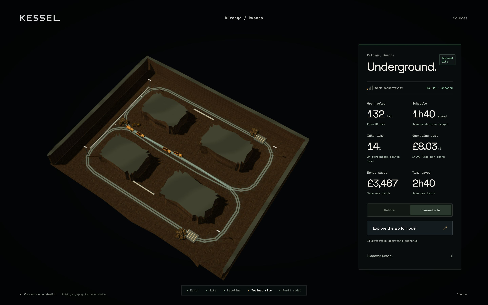
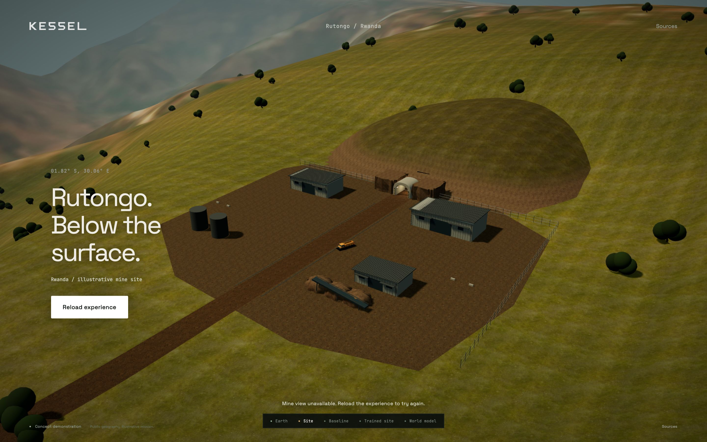

# Mine transition recovery

7 November 2026. Refs #295. Investigation starts at `9094647`.

The maintainer reports that the trained-site journey stays on the outer
surface and the presentation looks unchanged. The localhost server serves
the current checkout byte-for-byte. A clean native Chrome session completes
the normal-motion journey. The exact state of the maintainer's existing tab
has not been captured, so cached files remain a possible cause rather than a
confirmed diagnosis of that tab.

## Reproduced defect

Removing `visuals.entrance` from the scene response reproduces a frozen outer
surface on the previous code. The app first sets `stage=entering` and hides
the surface panel, then throws while reading `portal_alignment_node`, before
installing the transition. The observed error is:

```text
Cannot read properties of undefined (reading 'portal_alignment_node')
```

The scene remains on the surface with its controls hidden. Asset errors had
a handler, but errors in the subsequent transition setup did not.

## Change

Validate the entrance offsets and alignment node, load the mine and prepare
the camera transition before committing the stage or hiding controls. Missing
settings keep the surface visible with an enabled Reload experience button.
Transient mine asset errors retain Try again. The comparison explicitly hides
the surface and shows the mine. Diagnostics expose the presentation version
and actual scene-root visibility alongside the logical stage.

Version the application entry, local module import map and three styles with
one presentation revision. Fetch scene and vehicle configuration without
reusing HTTP-cached JSON. Keep static image/model binaries and the pinned
Three.js vendor URLs unchanged. This remains a static site with no build step.
The maintainer's separate wordmark-position edit is preserved.

## Verification

[Cache and recovery report](transition-evidence/cache-and-recovery.json).
Chrome 156.0.8078.81, native ANGLE Metal Renderer: Apple M1.

`scripts/verify-transition.cjs` uses a real HTTP server and browser cache. It
primes old unversioned modules, styles and scene JSON with a one-hour lifetime,
then serves the current page in the same browser context. No Playwright request
routing is used for this cache test.

- Without versioned URLs, the negative control executes the cached old entry
  and never initialises the current experience.
- With the current revision, no cached old module executes, fresh scene JSON
  is requested, and surface → mine → trained succeeds. The surface root is
  hidden, the mine root visible and throughput reads the authored 132 t/h.
  Before/after reversal also succeeds.
- With missing entrance settings, the surface and enabled reload button remain
  visible with no uncaught error. Restoring the data and using that button
  reloads successfully; the same mine/trained/reversal checks then pass.

A separate localhost normal-motion run also completes entering and comparing
with the current revision and correct scene-root visibility. Existing scene
and asset validators pass. The presentation-version check guards module/style
coverage and ensures diagnostic imports reuse the active application instance.
The recorded learning behaviour remains outside this fix.

For subsequent JavaScript/style releases, update the presentation revision in
`index.html` consistently and run `scripts/verify-presentation-version.py` plus
the browser regression. An already-open tab still needs one page reload to
execute the updated entry.

Sources: [Fetch cache modes](https://fetch.spec.whatwg.org/#concept-request-cache-mode),
[HTML import maps](https://html.spec.whatwg.org/multipage/webappapis.html#import-maps).




