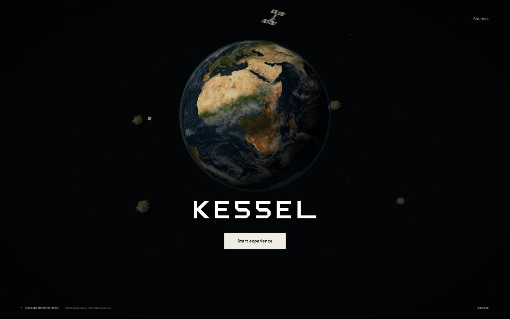
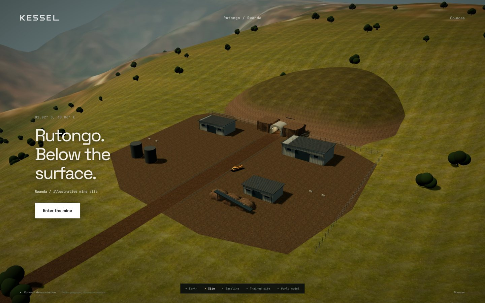
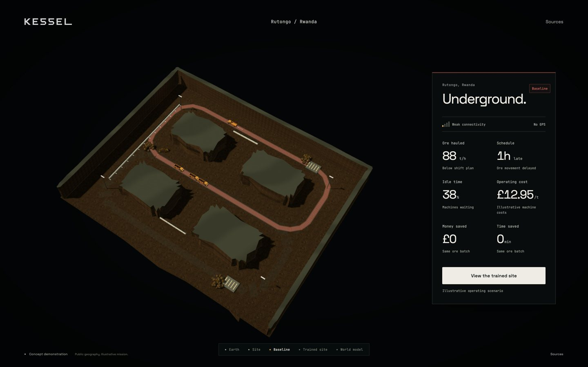
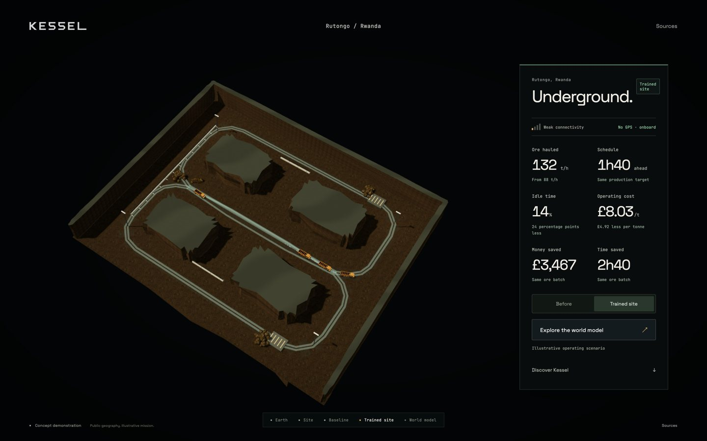
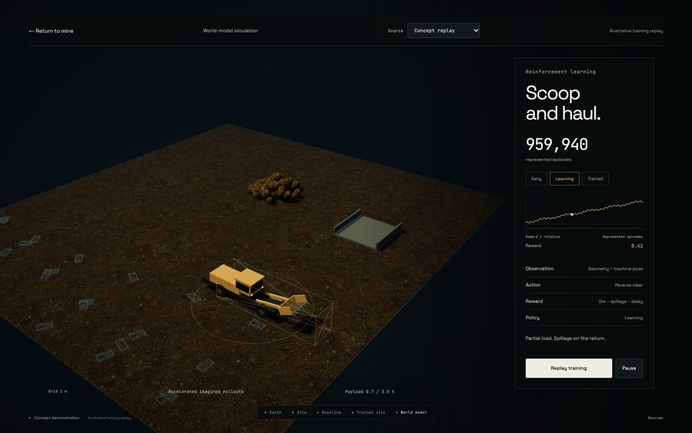
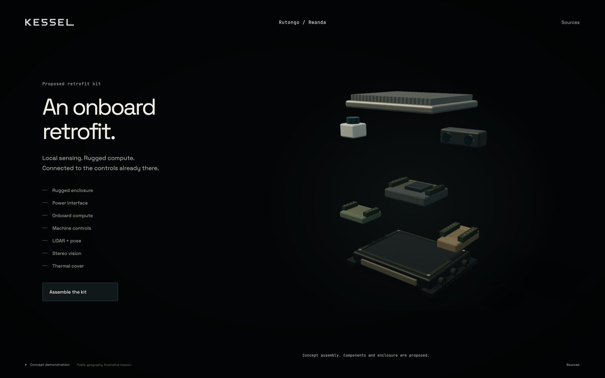

# Cinematic visual realism

6 November 2026. ADR-0045. Visual work #253–#270 and layout #277–#281.
The maintainer has deferred the reported recorded-demo behaviour problems.
This pass changes presentation and the authored mine; it does not validate
recorded playback, a complete learned delivery cycle or deployment savings.

## What changed

The hero keeps its established latitude/longitude basis and NASA Earth maps.
Clouds now receive sunlight, the atmosphere and night layer share a sun
direction, and a 100 kB simplified NASA ISS silhouette replaces one original
satellite. Its orbit is decorative. The original satellite remains a loading
fallback. The lower local wordmark placement is preserved as an existing,
uncommitted maintainer edit; it is not included in this branch's commits.

The surface blends the retained Sentinel/Copernicus context into cleared
15 m aerial ground detail. The authored foreground has a graded forecourt,
open extruded portal collar, rocky hillside, corrugated service buildings,
conveyor, stockpiles, drainage, fencing and a parked original hauler. It is not
a reconstruction of Rutongo or imagery with survey-level ground detail.

The roof-off mine now uses closed, irregular rock bodies with clean section
caps, metre-scaled triplanar natural rock, local haul-road wear, ventilation,
pipes, hangers and fixtures. Contours stay inside the existing clearance
bounds. The shell contains 2,048 triangles, below the 12,000-triangle budget.
Rock Face 03 was selected following the matched 2.7 m
[look-development comparison](lookdev/verification.md); Dark Rock 02 remains
retained as an alternative. Masonry is no longer used by the active scenes.

The existing CC BY excavator remains byte-for-byte intact. Loading joints
now ease towards their bounded authored offsets. Hauler wheels account for
travel at route closure, paint/rubber/glass use dielectric finishes, and the
original hauler gains small guards and exposed fittings. Partial bed loads
remain attached to the bed. A bounded instanced fragment effect follows the
authored loading/tipping phases. These fragments are decorative; they do not
change simulator material, outcomes or evidence. Eighty contact-dust slots
are capped, reused and disabled for reduced motion.

The comparison retains mapped machine positions and keeps machines visible
during the scan. The portal-to-section camera moves through an authored
alignment rather than revealing an unrelated rectangle. HUD tokens, panel
hierarchy, tabular values, source-aware chart axes and a quiet journey
indicator are shared across the application. Low connectivity and no GPS
remain visible in both comparison states. No live telemetry was invented.

The proposed kit has distinct metal, resin and glass finishes, board traces,
headers, connector collars, gaskets, mounting feet and restrained reflections
from the existing offline-prefiltered studio map. One presentation clock
handles its motion and reduced-motion assembly state.

## Asset and compression decisions

[Material manifests](../../assets/materials/manifest.json) retain source and
derivative hashes, licences, colour spaces and repeat scales. The
[surface manifest](../../assets/materials/surface-manifest.json) identifies
Aerial Grass Rock by Rob Tuytel. All new ground/rock maps are verified CC0.
The main four rock maps transfer 1,052,766 bytes. Colour remains 1K; linear
OpenGL normal, AO and roughness maps are 512 px. Estimated RGBA mip allocation
is about 9.8 MB for that set; actual driver allocation is not measured.

[Compression measurements](visual-evidence/compression.json) use the pinned
Three.js r160 and the native M1 renderer. Six local serial samples measure
fetch plus CPU decode/transcode and upload submission, not GPU fences or
remote network latency.

| Candidate | Transfer | Cold / warm median |
| --- | ---: | ---: |
| Rock diffuse JPEG | 927,082 B | 31.2 / 21.3 ms |
| Rock diffuse WebP | 264,894 B | 41.7 / 32.6 ms |
| UASTC KTX2, with mips | 1,398,640 B | 115.5 / 20.7 ms |
| ISS plain GLB | 100,116 B | 6.5 / 1.8 ms |
| ISS Meshopt GLB | 31,856 B | 3.3 / 2.0 ms |

KTX2 also needs the r160 loader/parser/worker, Basis JS and 499,935-byte WASM.
It works on the pinned renderer but increases transfer for this diffuse map.
Meshopt saves about 42 kB under gzip before its 6.4 kB gzipped decoder. Keep
the small plain GLB and native WebP decode path to avoid another runtime
loading path for one decorative object. Larger scenes can revisit GPU compression. Preparation
tools, downloaded originals and comparison decoders remain outside the site.

The NASA source is 44,495,916 bytes. The derivative removes textures and
markings, preserves the structural silhouette at 6,068 triangles and needs
no runtime mesh extension. Its [manifest](../../assets/models/iss/manifest.json)
records the credit, notices, hash and exact conversion. The licensed
excavator's joints, texture and source geometry are not simplified.

## Verification

[Native report](visual-evidence/native.json),
[frame manifest](visual-evidence/frames.json) and
[before/after frames](visual-evidence/frames/) are retained. Chrome
156.0.8078.81 reports ANGLE Metal Renderer: Apple M1. The complete authored
journey was checked at 1440 × 900 with device scale 2, renderer DPR capped at
1.5, and 1280 × 800 with reduced motion and DPR 1.

Twenty settled samples run at 59.7–60.0 fps; their largest p99 frame time is
16.8 ms. These samples follow stage warm-up. They do not measure every
first-use upload/compilation hitch, qualify another GPU or establish spare
GPU headroom beyond vsync. Main-pass counts range from 13 calls at the hero
to 255 at the trained mine and 99 at the kit. Three.js resets its reported
render counts after the shadow pass, so these are not total GPU draw counts.
The shadow map is one 1024² directional map per active stage. Two bounded
mine point lights do not cast shadows.

Effects-on, effects-off and the cheaper static-shadow tier remain near
60 fps in these settled native samples. The cheaper tier captures a static
geology shadow field, removes moving-machine shadow casting and keeps
contact shadows, avoiding material recompilation. It also disables dust.
Adaptive DPR is retained. These comparisons demonstrate the tested frame
budget, not an isolated GPU timing for each effect.

Browser checks cover capped/manifold geometry, clearance bounds, the southern
latitude of Rwanda and north-axis orientation, laptop panel bounds, no GPS in
both comparison states, source notices, keyboard entry/dialog dismissal,
comparison reversal, return from learning, kit assembly and replay. There are
no page, shader or HTTP errors in these checks. Source-mode material/axis
[checks](visual-evidence/material-check.json) follow the final uniform-only
loader finish change and were repeated against the clean packaged site. They do not
resolve the reported recorded-demo defects.

The visual-asset verifier checks eleven map hashes and their metadata, the
NASA triangle/transfer budget, intact licensed rig, forward-axis scale and
service headroom. Existing mission/experience validators, three preparation
tests, four recorded-adapter tests and all retained evidence verifiers pass.
The static packager includes the visual assets without npm tools, downloaded
originals or training code.

## Ticket disposition

Implementation is ready for review for #253–#260, #262–#270 and #277–#281.
Build tickets remain open with `pending-release` after merge under repository
policy. Final human visual acceptance and the wider Phase 11 release remain
separate work. This report does not close #271–#276.

#261 is partial. The authored mine's attached partial loads and decorative
fragments are implemented. Verification of exported material-transfer events,
source depletion and receiver deposition belongs with the deferred recorded
demo work. No fabricated transfer was added to the recorded evidence.

## Principal frames

